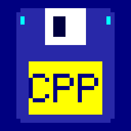
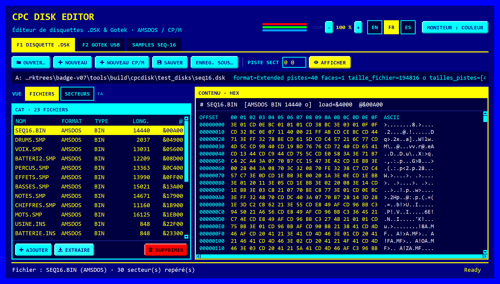
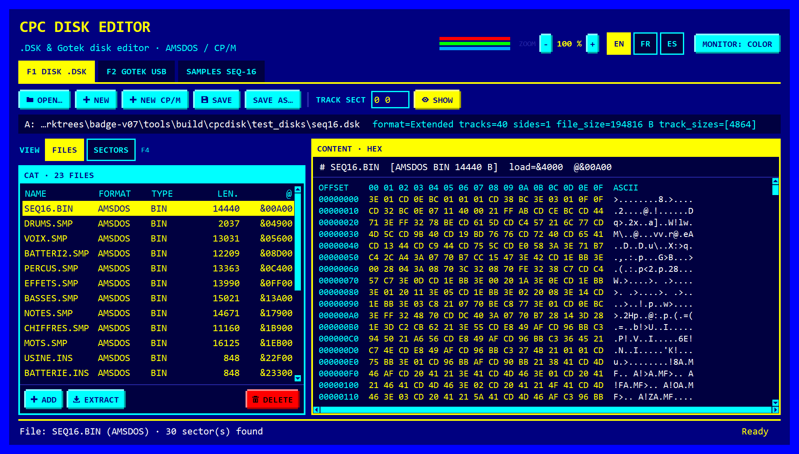
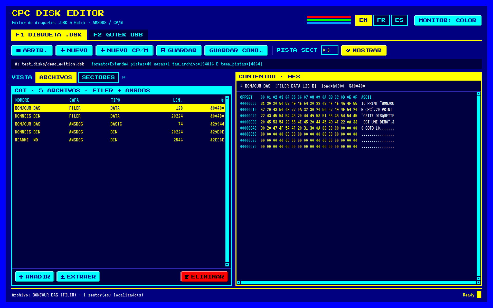
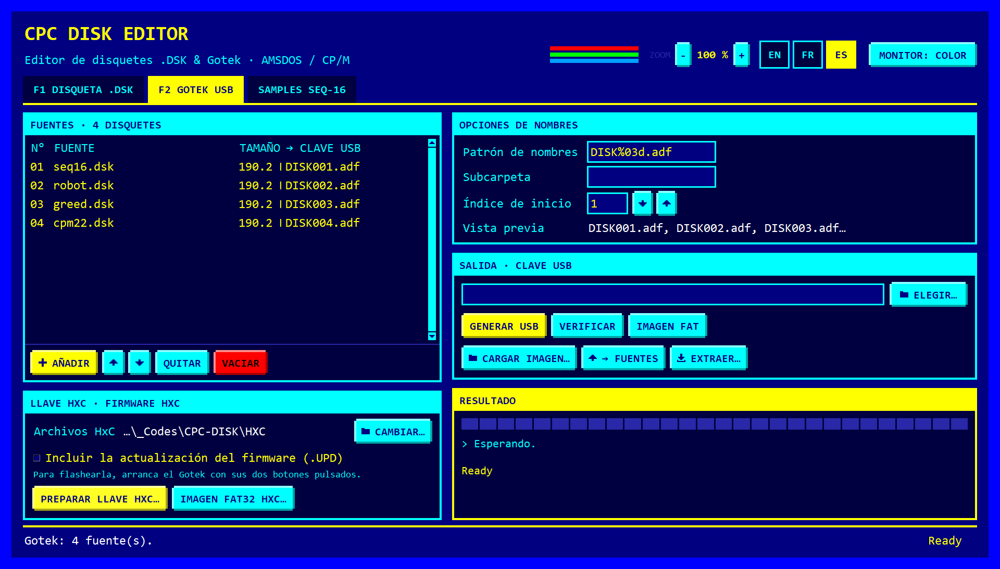

<div align="center">



```
 ██████╗██████╗  ██████╗    ██████╗ ██╗███████╗██╗  ██╗
██╔════╝██╔══██╗██╔════╝    ██╔══██╗██║██╔════╝██║ ██╔╝
██║     ██████╔╝██║         ██║  ██║██║███████╗█████╔╝
██║     ██╔═══╝ ██║         ██║  ██║██║╚════██║██╔═██╗
╚██████╗██║     ╚██████╗    ██████╔╝██║███████║██║  ██╗
 ╚═════╝╚═╝      ╚═════╝    ╚═════╝ ╚═╝╚══════╝╚═╝  ╚═╝
        É D I T E U R   .DSK  ·  G O T E K  ·  A M S D O S

Ready
█
```

**Éditeur d'images disquette `.dsk` pour Amstrad CPC, avec préparation de clé USB pour lecteur Gotek.**
Une interface au look « écran CPC », en pur Python, sans aucune dépendance externe.


[](https://www.buymeacoffee.com/ChristopheCruz)

[🇫🇷 Français](README.fr.md) · [🇬🇧 English](README.md)

</div>

---



## Sommaire

- [Fonctionnalités](#fonctionnalités)
- [Installation](#installation)
- [Lancement](#lancement)
- [Utilisation](#utilisation)
- [Raccourcis clavier](#raccourcis-clavier)
- [Structure du projet](#structure-du-projet)
- [Soutenir le projet](#soutenir-le-projet)
- [Crédits](#crédits)
- [Voir aussi](#voir-aussi)
- [Licence](#licence)

## Fonctionnalités

### Onglet Disquette (`.dsk`)

- **Ouvrir, créer, sauver** des images disquette au format EXTENDED CPC DSK (les `.adf` sont aussi acceptés).
- **Catalogue AMSDOS** : le même que celui que lit le CPC (64 entrées, blocs de 1 Ko), pour les disquettes DATA (`&C1..&C9`) et SYSTEM/CP-M (`&41..&49`). Nom, type, longueur, adresse ; numéros d'utilisateur (`1:JEU.BAS`).
- **Ajouter un fichier local** : nom 8.3, type (Basic ou binaire), adresse de chargement, **avec en-tête AMSDOS** (comme `SAVE`) ou **en données brutes** (texte, programme CP/M). L'espace est pris dans les blocs libres, comme le fait AMSDOS.
- **Extraire** un fichier vers le disque local (`MONPROG.BAS` → `monprog.bas`), sans son en-tête.
- Une disquette d'un format inconnu est lue « au mieux » par l'ancien balayage d'en-têtes.
- **Supprimer** un fichier, avec confirmation.
- **Dump hexadécimal** d'un fichier ou d'un secteur, sur trois colonnes alignées : offset, octets, ASCII.
- **Carte des secteurs** cliquable : la géométrie est lue sur l'image, les secteurs libres (remplis de `E5` ou de `00`) sont distingués des secteurs occupés, et ceux du fichier sélectionné sont surlignés.

### Support CP/M 2.2

- **Disques système CP/M 2.2 amorçables** (« System format », 40 pistes × 9 × 512, IDs de secteur `&41..&49`) : le bouton **Nouveau CP/M** (ou `cpc-dsk new x.dsk --cpm`) en génère un à partir d'une image de référence extraite d'un cpm22.dsk réel — CP/M 2.2 + Amsdos 2.0 (`AMSDOS.COM`, `DISCKIT2.COM`, `LOGO2.COM`, `LOGO2.SUB`), prêt à tester sur un Gotek réel.
- **Détection automatique** des disques CP/M : le catalogue est celui de CP/M 2.2 (piste 2, 64 entrées, blocs de 1 Ko). Les fichiers avec en-tête AMSDOS sont reconnus (ex. `RITDEMO.BIN`, 11 264 o).
- Spécificités des disques réels gérées : bits d'attribut dans les noms (Planetfall), ordre des IDs de secteur séquentiel ou entrelacé (Track-Infos identiques à WinAPE sur les disques générés).

### Onglet Gotek (clé USB)

- **Liste de sources** `.dsk` / `.adf`, réordonnable avec ▲ ▼.
- **Patron de noms** (par défaut `DISK%03d.adf`), sous-dossier et index de départ, avec un aperçu des noms en direct.
- **Générer** le répertoire à copier sur la clé USB du Gotek.
- **Vérifier** un dossier existant.
- **Créer une image FAT16** complète de la clé (32 Mo) grâce à un rédacteur FAT intégré, sans outil externe.
- **Charger une image `.img`** existante : liste de son contenu, renvoi des disquettes vers la pile de sources, ou extraction dans un dossier.
- **Clé HxC** : préparer une clé USB pour un Gotek équipé du firmware HxC (voir [Clé HxC](#clé-hxc)).

### Onglet Samples SEQ-16

Un éditeur de banques de samples pour **[SEQ-16](https://github.com/ChristopheCruz/CPC-SEQ-16)**, le tracker chiptune 4 voix du CPC (en français, anglais et espagnol), intégré en troisième onglet (il se lance aussi seul : `python -m cpc_dsk.seq16.smp_gui`).

- **WAV → banque `.SMP`** : 16 samples au plus, convertis sur les 16 niveaux de volume mesurés de l'AY-3-8912. Réglages de chaque sample : nom, fréquence (4 000 à 16 000 Hz, ou la période en NOP), bits, décimation, courbe, drive, trim, clean, tramage, découpage en N tranches égales. Une banque `.SMP` existante se rouvre (réglages de fiche seulement).
- **Aperçu** : forme d'onde du WAV d'origine et du rendu CPC simulé, sur la même échelle de temps, et écoute des deux.
- **Jauge de mémoire** : la banque doit tenir en 16 320 octets de données (mémoire principale du CPC, `#0040-#3FFF`) ; une banque trop grande ne peut pas être sauvée.
- **Sauver** le `.SMP` et l'**ajouter à une disquette** : celle ouverte dans l'onglet Disquette (format DATA — elle est sauvée et son catalogue rafraîchi) ou un autre fichier `.dsk`. Le fichier reçoit un en-tête AMSDOS, comme sur le CPC.
- En ligne de commande : `python -m cpc_dsk.seq16.wav2smp kick.wav snare.wav -o DRUMS.SMP [--dsk disque.dsk]`.

### Interface

- Look **Amstrad CPC** : palette du firmware (bleu, jaune vif, cyan), polices pixel, boutons en relief de 4 px, sélection en vidéo inverse et curseur `Ready` clignotant.
- **Deux moniteurs** : couleur (CTM644) ou vert (GT65), à basculer avec F3.
- **Trois langues d'interface** : anglais, français et espagnol — détectées depuis la locale système, changeables dans la fenêtre.
- **Glisser-déposer** depuis l'explorateur Windows.
- Compatible **haute résolution** : les polices pixel restent nettes à 125 %, 150 % et au-delà.

L'interface dans les deux autres langues (le visuel ci-dessus est en français) :

<table>
  <tr>
    <td align="center"></td>
    <td align="center"></td>
  </tr>
  <tr>
    <td align="center"><em>Anglais — onglet Disquette</em></td>
    <td align="center"><em>Anglais — onglet Gotek</em></td>
  </tr>
  <tr>
    <td align="center"></td>
    <td align="center"></td>
  </tr>
  <tr>
    <td align="center"><em>Espagnol — onglet Disquette</em></td>
    <td align="center"><em>Espagnol — onglet Gotek</em></td>
  </tr>
</table>

## Installation

Python 3.8 ou plus récent suffit. `tkinter` est fourni avec Python sous Windows et macOS.

```bash
git clone https://github.com/ChristopheCruz/CPC-DISK.git
cd CPC-DISK
```

Sous Linux, `tkinter` est parfois livré à part :

```bash
sudo apt install python3-tk      # Debian / Ubuntu
```

Les polices **Press Start 2P** et **VT323** sont fournies dans `cpc_dsk/fonts/`. Sous Windows, elles sont chargées pour l'application seule, sans rien installer sur le système. Ailleurs, ou si le dossier est absent, l'interface utilise automatiquement une police à chasse fixe. Pour avoir le rendu pixel sous Linux ou macOS, installe les deux `.ttf` dans tes polices utilisateur.

## Lancement

```bash
python -m cpc_dsk.gui
```

## Utilisation

### Éditer une disquette

1. **Ouvrir** une image `.dsk`, ou **Nouveau** pour partir d'une disquette vierge.
2. Sélectionne un fichier dans le catalogue : son contenu s'affiche en hexadécimal à droite.
3. **Ajouter**, **Extraire** ou **Supprimer** des fichiers. La disquette est sauvegardée après chaque modification.
4. Pour inspecter un secteur précis, saisis `piste secteur` (par exemple `0 0`) puis **Afficher**, ou clique directement dans la carte des secteurs (vue **Secteurs**, F4).

### Créer un disque système CP/M

1. **Nouveau CP/M** (ou `cpc-dsk new cpm.dsk --cpm`) → un disque CP/M 2.2 « System format » amorçable, avec les utilitaires Amsdos. `--no-utils` produit un système nu (répertoire vide).
2. **Ajoute** tes programmes (données brutes pour un `.COM`, en-tête AMSDOS pour un binaire CPC), puis **Sauve**.
3. Copie l'image sur la clé du Gotek (onglet Gotek, `DISK001.adf`) et amorçes-la sur un vrai CPC : le BIOS `|CPM` charge le secteur de boot, le système démarre sur `A>` et lit le répertoire de la piste 2.
4. Les disques CP/M existants (réels ou home-brew) sont détectés automatiquement : ouvre-en un, le catalogue liste ses fichiers CP/M.

```bash
cpc-dsk list cpm.dsk --source cpm       # répertoire CP/M
cpc-dsk list cpm.dsk --source amsdos    # objets AMSDOS
cpc-dsk read cpm.dsk PROG.COM --out prog.com
cpc-dsk write cpm.dsk MYPGM.BIN mypgm.bin --load 0x4000
```

### Préparer une clé pour le Gotek

1. Dans l'onglet **Gotek** (F2), **Ajoute** les disquettes, puis mets-les dans l'ordre voulu avec ▲ ▼.
2. Ajuste si besoin le patron de noms, le sous-dossier et l'index de départ. La colonne « → clé USB » montre le nom que portera chaque image.
3. Choisis le dossier de sortie (la racine de la clé, par exemple), puis **Générer USB**.
4. Pour une clé neuve, **Image FAT** produit à la place une image `.img` complète, à graver sur la clé.


### Clé HxC

Le bloc **Clé HxC** de l'onglet Gotek prépare une clé USB pour un Gotek équipé du **firmware HxC** d'HxC2001. Ce firmware lit directement les fichiers Amstrad `.DSK` (sans conversion) sur une clé FAT32, et affiche un sélecteur de fichiers sur le CPC.

Les fichiers HxC ne sont **pas distribués avec CPC DISK** : le firmware appartient à HxC2001 (vendu sur leur boutique). Télécharge l'archive officielle sur <https://hxc2001.com/docs/gotek_hxc_firmware/pages/download.html> et place ces fichiers dans un dossier `HXC` à côté du programme (à côté de `cpc-dsk-gui.exe`, ou à la racine du projet), ou indique-le avec le bouton **Changer…** ou la variable d'environnement `CPC_DISK_HXC` :

- `AUTOBOOT.HFE` et `HXCSDFE.CFG`, dans `File_Selector/Amstrad_CPC/` ;
- en option la mise à jour du firmware `.UPD`, dans `Firmwares_Updates/Generic_Gotek/Standard_Firmware/`.

Ensuite :

- **Préparer clé HxC…** copie `AUTOBOOT.HFE`, `HXCSDFE.CFG` et les disquettes de la liste des sources (renommées en 8.3 majuscules, `ROBOT.DSK`…) à la racine de la clé. Sous Windows, seuls les lecteurs amovibles sont acceptés ; si la clé n'est pas en FAT32, CPC DISK propose d'ouvrir la fenêtre « Formater » de Windows (c'est là que tu confirmes le formatage). Les fichiers de même nom sur la clé sont remplacés, les autres ne sont pas touchés.
- **Image FAT32 HxC…** fabrique une image `.img` FAT32 complète (rédacteur intégré, sans outil externe), à écrire sur la clé avec Rufus ou balenaEtcher (ou `dd`).
- **Inclure la mise à jour du firmware (.UPD)** copie aussi le `.UPD` de plus haute version ; pour le flasher, démarre le Gotek avec ses deux boutons enfoncés.

### Glisser-déposer (Windows)

| Ce que tu déposes | Onglet actif | Résultat |
|---|---|---|
| `.dsk` / `.adf` | Disquette, aucun disque ouvert | la disquette s'ouvre |
| `.dsk` / `.adf` | Disquette, un disque ouvert | ajouté aux sources Gotek |
| `.dsk` / `.adf` | Gotek | ajouté aux sources |
| tout autre fichier | Disquette / Gotek | ajouté à la disquette ouverte |
| `.wav` / `.smp` | Samples SEQ-16 | WAV ajouté à la banque / banque ouverte |

## Raccourcis clavier

| Touche | Action |
|---|---|
| <kbd>F1</kbd> / <kbd>F2</kbd> | Onglet Disquette / Gotek |
| <kbd>F3</kbd> | Moniteur couleur / vert |
| <kbd>F4</kbd> | Vue Fichiers / Secteurs |
| <kbd>Ctrl</kbd>+<kbd>O</kbd> | Ouvrir une disquette (onglet Samples : ouvrir une banque `.SMP`) |
| <kbd>Ctrl</kbd>+<kbd>N</kbd> | Nouvelle disquette |
| <kbd>Ctrl</kbd>+<kbd>S</kbd> | Sauver (onglet Samples : sauver la banque `.SMP`) |
| <kbd>Ctrl</kbd>+<kbd>W</kbd> | Onglet Samples : ajouter des WAV |
| <kbd>Suppr</kbd> | Supprimer le fichier ou la source sélectionnés |
| <kbd>Entrée</kbd> (champ secteur) | Afficher le secteur |

## Structure du projet

```
cpc_dsk/
├── gui.py            Interface graphique tkinter (habillage pixel art)
├── cli.py            Interface en ligne de commande
├── i18n.py           Chaînes d'interface (en / fr / es)
├── data/
│   └── cpm22_system.bin   CP/M 2.2 + Amsdos 2.0 : pistes système + 4 utilitaires (scripts/make_cpm_reference.py)
├── fonts/            Press Start 2P et VT323 (licence OFL)
├── seq16/            Onglet Samples SEQ-16
│   ├── wav2smp.py    Conversion WAV → .SMP (+ ligne de commande)
│   ├── smp_model.py  Modèle de l'éditeur de banques (sans interface)
│   ├── smp_gui.py    Éditeur de banques (onglet ou fenêtre autonome)
│   └── dskio.py      Ajout d'une banque à une disquette DATA (par core/amsdos.py)
└── core/
    ├── adf.py        Lecture et écriture des images disquette
    ├── amsdos.py     Catalogue AMSDOS / CP/M (formats DATA et SYSTEM) : lecture, écriture, suppression
    ├── cpcfs.py      En-têtes AMSDOS, balayage de secours (formats inconnus)
    ├── cpm.py        CP/M 2.2 (« System format ») : système de fichiers + générateur de disque
    ├── gotek.py      Préparation de la clé USB et rédacteur FAT16
    ├── fat32.py      Rédacteur d'images FAT32 intégré
    └── hxc.py        Clé HxC (fichiers du firmware HxC + disquettes)
```

## Soutenir le projet

CPC Disk Editor est gratuit et le restera. S'il t'a évité quelques heures de manipulations de disquettes, ou s'il a redonné vie à un vieux 6128 grâce au Gotek, tu peux m'offrir un café : ça finance du temps pour les prochaines fonctionnalités.

<div align="center">

<a href="https://www.buymeacoffee.com/ChristopheCruz" target="_blank">
  
</a>

```
10 PRINT "MERCI !"
20 GOTO 10
```

</div>

Une étoile ⭐ sur le dépôt, un signalement de bug ou une idée dans les *issues* aident tout autant.

## Crédits

- **Press Start 2P** par CodeMan38 et **VT323** par Peter Hull, distribuées sous [SIL Open Font License 1.1](https://openfontlicense.org). Leurs licences sont dans `cpc_dsk/fonts/`.
- Amstrad et CPC sont des marques de leurs détenteurs respectifs. Ce projet n'est affilié à aucun d'eux.

## Voir aussi

- **[SEQ-16](https://github.com/ChristopheCruz/CPC-SEQ-16)** : un tracker chiptune pour l'Amstrad CPC 6128 (séquenceur, instruments, samples et digidrums). Il utilise la bibliothèque disque de ce projet (`cpc_dsk`) pour fabriquer ses disquettes, et son éditeur de samples est l'onglet Samples SEQ-16.

## Licence

[MIT](LICENSE) — voir le fichier `LICENSE` à la racine du dépôt.
