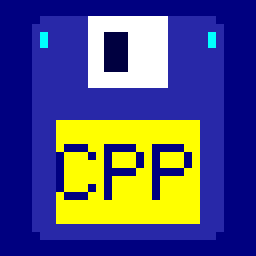

<div align="center">


```
 ██████╗██████╗  ██████╗    ██████╗ ██╗███████╗██╗  ██╗
██╔════╝██╔══██╗██╔════╝    ██╔══██╗██║██╔════╝██║ ██╔╝
██║     ██████╔╝██║         ██║  ██║██║███████╗█████╔╝
██║     ██╔═══╝ ██║         ██║  ██║██║╚════██║██║═██╗
╚██████╗██║     ╚██████╗    ██████╔╝██║███████║██║  ██╗
 ╚═════╝╚═╝      ╚═════╝    ╚═════╝ ╚═╝╚══════╝╚═╝  ╚═╝
        D I S K   E D I T O R   .DSK  ·  G O T E K  ·  A M S D O S

Ready
█
```

**CPC `.dsk` disk image editor, with USB key preparation for Gotek readers.**
A "CPC screen"-looking interface, in pure Python, with no external dependencies.




[](https://www.buymeacoffee.com/ChristopheCruz)

[🇬🇧 English](README.md) · [🇫🇷 Français](README.fr.md)

</div>

---


## Table of Contents

- [Features](#features)
- [Installation](#installation)
- [Running](#running)
- [Usage](#usage)
- [Keyboard shortcuts](#keyboard-shortcuts)
- [Project structure](#project-structure)
- [Supporting the project](#supporting-the-project)
- [Credits](#credits)
- [See also](#see-also)
- [License](#license)

## Features

### Diskette tab (`.dsk`)

- **Open, create, and save** disk images in the EXTENDED CPC DSK format (`.adf` files are also accepted).
- **AMSDOS catalogue**: the same one the CPC reads (64 entries, 1 KB blocks), for DATA (`&C1..&C9`) and SYSTEM/CP-M (`&41..&49`) diskettes. Name, type, length, load address; user numbers (`1:GAME.BAS`).
- **Add a local file**: 8.3 name, type (Basic or binary), load address, **with an AMSDOS header** (like `SAVE`) or **as raw data** (text, CP/M program). Space is taken from free blocks, as AMSDOS does.
- A diskette in an unknown format is read on a best-effort basis by the old header scan.
- **Extract** a file to the local disk, keeping its extension (`MONPROG BAS` → `monprog.bas`).
- **Delete** a file, with confirmation.
- **Hex dump** of a file or a sector, in three aligned columns: offset, bytes, ASCII.
- **Clickable sector map**: the geometry is read from the image, free sectors (filled with `E5` or `00`) are distinguished from in-use sectors, and those belonging to the selected file are highlighted.

### CP/M 2.2 support

- **Bootable CP/M 2.2 system disks** ("System format", 40 tracks × 9 × 512, sector IDs `&41..&49`): the **New CP/M** button (or `cpc-dsk new x.dsk --cpm`) builds one from a reference image extracted from a real cpm22.dsk — CP/M 2.2 + Amsdos 2.0 (`AMSDOS.COM`, `DISCKIT2.COM`, `LOGO2.COM`, `LOGO2.SUB`), ready to test on a real Gotek.
- **Automatic detection** of CP/M disks: the catalogue is the CP/M 2.2 one (track 2, 64 entries, 1 KB blocks). Files with an AMSDOS header are recognised (e.g. `RITDEMO.BIN`, 11,264 bytes).
- Real-disk quirks handled: CP/M character set names (Planetfall), sequential or interleaved sector ID orders (WinAPE-identical track headers on generated disks).

### Gotek tab (USB key)

- **Source list** of `.dsk` / `.adf` images, reorderable with ▲ ▼.
- **Naming pattern** (default `DISK%03d.adf`), subfolder and start index, with a live preview of the resulting names.
- **Generate** the directory to copy onto the Gotek's USB key.
- **Verify** an existing directory.
- **Create a full FAT16 image** of the key (32 MB) with a built-in FAT writer, no external tool needed.
- **Load an existing `.img` image**: list its content, send its diskettes back to the source stack, or extract everything to a folder.

### Samples SEQ-16 tab

A sample-bank editor for **[SEQ-16](https://github.com/ChristopheCruz/CPC-SEQ-16)**, the 4-voice chiptune tracker for the CPC (in English, French and Spanish), built in as a third tab (also runs on its own: `python -m cpc_dsk.seq16.smp_gui`).

- **WAV → `.SMP` bank**: up to 16 samples, converted to the AY-3-8912's 16 measured volume levels. Per-sample settings: name, frequency (4,000 to 16,000 Hz, or the period in NOP), bits, decimation, curve, drive, trim, clean, dither, slicing into N equal parts. Existing `.SMP` banks can be reopened (entry settings only).
- **Preview**: waveform of the original WAV and of the simulated CPC rendering, on the same time scale, and playback of both.
- **Memory gauge**: the bank must fit in 16,320 bytes of data (CPC main memory, `#0040-#3FFF`); a bank that is too big cannot be saved.
- **Save** the `.SMP` file and **add it to a diskette**: the diskette open in the Disk tab (DATA format — it is saved and its catalogue refreshed) or any other `.dsk` file. The file gets an AMSDOS header, as on the CPC.
- Command line: `python -m cpc_dsk.seq16.wav2smp kick.wav snare.wav -o DRUMS.SMP [--dsk disk.dsk]`.

### Interface

- **Amstrad CPC** look: firmware palette (blue, bright yellow, cyan), pixel fonts, 4-px relief buttons, reverse-video selection and a blinking `Ready` cursor.
- **Two monitors**: colour (CTM644) or green (GT65), toggled with F3.
- **Three interface languages**: English, French and Spanish — detected from the system locale, switchable in the window.
- **Drag & drop** from the Windows Explorer.
- **Hi-DPI friendly**: pixel fonts stay crisp at 125 %, 150 % and beyond.

The interface in the other two languages (the banner above is French):

<table>
  <tr>
    <td align="center"></td>
    <td align="center"></td>
  </tr>
  <tr>
    <td align="center"><em>English — diskette tab</em></td>
    <td align="center"><em>English — Gotek tab</em></td>
  </tr>
  <tr>
    <td align="center"></td>
    <td align="center"></td>
  </tr>
  <tr>
    <td align="center"><em>Spanish — diskette tab</em></td>
    <td align="center"><em>Spanish — Gotek tab</em></td>
  </tr>
</table>

## Installation

Python 3.8 or newer is all you need. `tkinter` ships with Python on Windows and macOS.

```bash
git clone https://github.com/ChristopheCruz/CPC-DISK.git
cd CPC-DISK
```

On Linux, `tkinter` is sometimes a separate package:

```bash
sudo apt install python3-tk      # Debian / Ubuntu
```

The **Press Start 2P** and **VT323** fonts are included in `cpc_dsk/fonts/`. On Windows they are loaded for the application only — nothing is installed on the system. Elsewhere, or if the folder is missing, the interface automatically falls back to a monospace font. For the pixel look on Linux or macOS, install the two `.ttf` files in your user fonts.

## Running

```bash
python -m cpc_dsk.gui
```

## Usage

### Editing a diskette

1. **Open** a `.dsk` image, or start from a blank one with **New**.
2. Select a file in the catalogue: its content is shown as hex on the right.
3. **Add**, **Extract** or **Delete** files. The diskette is saved after every change.
4. To inspect a specific sector, type `track sector` (e.g. `0 0`) then **Show**, or click directly in the sector map (**Sectors** view, F4).

### Building a CP/M system disk

1. **New CP/M** (or `cpc-dsk new cpm.dsk --cpm`) → a bootable CP/M 2.2 "System format" disk with the Amsdos utilities. `--no-utils` produces a bare system (empty directory).
2. **Add** your programs (raw data for a `.COM`, AMSDOS header for a CPC binary), then **save**.
3. Copy the image to the Gotek's key (Gotek tab, `DISK001.adf`) and boot it on a real CPC: the BIOS `|CPM` loads the boot sector, the system comes up at `A>` and reads the track-2 directory.
4. Existing CP/M disks (real or home-brew) are detected automatically: open one and the catalogue shows its CP/M files, "legacy" files included (e.g. `RITDEMO.BIN` on cpm22.dsk).

```bash
cpc-dsk list cpm.dsk --source cpm       # CP/M directory
cpc-dsk list cpm.dsk --source amsdos    # AMSDOS objects
cpc-dsk read cpm.dsk PROG.COM --out prog.com
cpc-dsk write cpm.dsk MYPGM.BIN mypgm.bin --load 0x4000
```

### Preparing a key for the Gotek

1. In the **Gotek** tab (F2), **Add** your diskettes, then put them in the desired order with ▲ ▼.
2. Adjust the naming pattern, subfolder and start index if needed. The "→ USB key" column shows the name each image will get.
3. Choose the output directory (the root of the key, for example), then **Generate USB**.
4. For a blank key, **FAT image** instead produces a complete `.img` to write onto the key.


### Drag & drop (Windows)

| What you drop | Active tab | Result |
|---|---|---|
| `.dsk` / `.adf` | Diskette, no disk open | the diskette is opened |
| `.dsk` / `.adf` | Diskette, a disk open | added to the Gotek sources |
| `.dsk` / `.adf` | Gotek | added to the sources |
| any other file | Diskette / Gotek | added to the open diskette |
| `.wav` / `.smp` | Samples SEQ-16 | WAV added to the bank / bank opened |

## Keyboard shortcuts

| Key | Action |
|---|---|
| <kbd>F1</kbd> / <kbd>F2</kbd> | Diskette / Gotek tab |
| <kbd>F3</kbd> | Colour / green monitor |
| <kbd>F4</kbd> | Files / Sectors view |
| <kbd>Ctrl</kbd>+<kbd>O</kbd> | Open a diskette (Samples tab: open a `.SMP` bank) |
| <kbd>Ctrl</kbd>+<kbd>N</kbd> | New diskette |
| <kbd>Ctrl</kbd>+<kbd>S</kbd> | Save (Samples tab: save the `.SMP` bank) |
| <kbd>Ctrl</kbd>+<kbd>W</kbd> | Samples tab: add WAV files |
| <kbd>Del</kbd> | Delete the selected file or source |
| <kbd>Enter</kbd> (sector field) | Show the sector |

## Project structure

```
cpc_dsk/
├── gui.py            tkinter GUI (pixel-art skin)
├── cli.py            command-line interface
├── i18n.py           interface strings (en / fr / es)
├── data/
│   └── cpm22_system.bin   CP/M 2.2 + Amsdos 2.0 reference image (46 880 B)
├── fonts/            Press Start 2P and VT323 (OFL license)
├── seq16/            Samples SEQ-16 tab
│   ├── wav2smp.py    WAV → .SMP conversion (+ command line)
│   ├── smp_model.py  bank editor model (no GUI)
│   ├── smp_gui.py    bank editor (tab or standalone window)
│   └── dskio.py      add a bank to a DATA diskette (through core/amsdos.py)
└── core/
    ├── adf.py        disk image reader / writer
    ├── amsdos.py     AMSDOS / CP/M catalogue (DATA and SYSTEM formats): read, write, delete
    ├── cpcfs.py      AMSDOS headers, fallback scan (unknown formats)
    ├── cpm.py        CP/M 2.2 ("System format") filesystem + disk builder
    └── gotek.py      USB key preparation and FAT16 writer
```

## Supporting the project

CPC Disk Editor is free and will stay free. If it saved you a few hours of diskette fiddling, or brought an old 6128 back to life through a Gotek, you can buy me a coffee: it funds time for the next features.

<div align="center">

<a href="https://www.buymeacoffee.com/ChristopheCruz" target="_blank">
  
</a>

```
10 PRINT "THANKS !"
20 GOTO 10
```

</div>

A star ⭐ on the repository, a bug report or an idea in the *issues* helps just as much.

## Credits

- **Press Start 2P** by CodeMan38 and **VT323** by Peter Hull, released under the [SIL Open Font License 1.1](https://openfontlicense.org). Their licenses are in `cpc_dsk/fonts/`.
- Amstrad and CPC are trademarks of their respective owners. This project is not affiliated with any of them.

## See also

- **[SEQ-16](https://github.com/ChristopheCruz/CPC-SEQ-16)**: a chiptune tracker for the Amstrad CPC 6128 (sequencer, instruments, samples and digidrums). It uses this project's disk library (`cpc_dsk`) to build its diskettes, and its sample editor is the Samples SEQ-16 tab.

## License

[MIT](LICENSE) — see the `LICENSE` file at the root of the repository.
